# Arquitectura del CU-05

El sistema convierte pilas de microscopía en medidas nucleares trazables y
prepara un predictor experimental que recibe descriptores de la topografía.
La [visión por computador](specs/vision-por-computador.md) produce las medidas
observadas. La [integración few-shot](specs/integracion-llm-few-shot.md) propone
estimarlas para una consulta a partir de ejemplos medidos.

El estado de los componentes refleja el trabajo de la Entrega 2. El código
nuevo de μSAM, medición por tramos y few-shot está pendiente de subirse al fork.

## Mapa del sistema

```mermaid
flowchart TD
    A["Pila TIFF y metadatos Leica XML"] --> B["Lectura y calibración Z/Y/X"]
    B --> C["Cellpose 2D y asociación entre cortes"]
    B --> D["Anotador 3D de μSAM"]
    R["Revisión de núcleos y marcas en Z"] --> D
    C --> E["Máscaras por núcleo y procedencia"]
    D --> E
    E --> F["Medición física y control de calidad"]
    F --> G["CSV, incidencias y vistas para revisión"]
    F --> H["Preparación de pares por muestra"]
    T["Ficha experimental del scaffold y de las muestras"] --> H
    H --> I["Ejemplos por grupo y grupos reservados"]
    Q["Consulta de topografía"] --> L["Plantilla few-shot y adaptador LLM"]
    I -->|"ejemplos de entrenamiento"| L
    I -->|"medidas reservadas y media base"| V["Evaluación por grupo"]
    L --> J["Validación JSON y trazas de ejecución"]
    J --> V
```

## Componentes e interfaces

| Componente | Responsabilidad y datos que intercambia | Estado |
|---|---|---|
| Lectura y calibración | Ordena los planos, identifica el canal de trabajo y registra forma, espaciado Z/Y/X, exclusiones y huellas. Los originales se leen desde `data/`. | Implementado. [Lector original](src/topografia_celular/entrada.py) y [lector TIFF directo](src/topografia_celular/entrada_microsam.py). |
| Cellpose 2D y asociación | El piloto anterior propone etiquetas en cada plano. El postproceso las asocia en Z y registra huecos, divisiones y solapamientos dudosos. | Implementado para las pilas compatibles. [Procesamiento](docs/procesamiento.md). |
| Anotador de μSAM | Una persona guía y revisa un núcleo con puntos o cajas. Cada guardado enlaza la última revisión del núcleo con su máscara, indicaciones, polígonos o cajas y parámetros. Los contornos de núcleos guardados se muestran como referencia. | Implementado. [Flujo interactivo](docs/seleccion-nucleos.md). |
| Medición física | Cuenta vóxeles con escala física y calcula ejes equivalentes de la máscara observada. Para el piloto de tramos usa las dos paradas revisadas, un centro y una profundidad común. Produce volumen del tramo, incidencias y sensibilidad al desplazar la ventana. | Implementado. [Geometría](src/topografia_celular/medidas.py) y [medición por tramos](src/topografia_celular/tramos.py). |
| Tablas, máscaras y vistas | Permiten volver desde un valor hasta su revisión concreta. Los TIFF preparados, las sesiones JSON, las tablas y las vistas HTML viven en `output/`. Los pesos y la caché se guardan en `tmp/`. | Implementado. [Formato y reanudación](docs/seleccion-nucleos.md). |
| Pares por muestra | Une medidas revisadas con una ficha que vincula adquisición, muestra, grupo experimental, patrón y dimensión nominal. Resume por muestra mediante la mediana y conserva unidades, protocolo y número de núcleos. | Diseñado. Falta cerrar la revisión y confirmar procedencia. |
| Plantilla, adaptador y validación LLM | Recibe la consulta y ejemplos de entrenamiento, prepara el esquema JSON y valida estado, volumen y referencias a los ejemplos. Guarda modelo, configuración, prompt y respuesta. | Plantilla, validación y trazas probadas localmente con respuestas sintéticas. Conexión con el proveedor propuesta en el [ADR de few-shot](decisions/few-shot-estructurado-por-muestra.md). |
| Evaluación por grupo | Reserva muestras relacionadas en la misma partición. Compara el LLM y la media de entrenamiento con las mismas medidas reservadas mediante MAE y registra fallos y abstenciones. | Diseñado. La prueba independiente requiere grupos suficientes y comparables. |

## Flujo de principio a fin

1. **Preparar una pila.** La calibración fija el significado físico de la
   máscara. El flujo actual con μSAM abre TIFF directo, guarda un manifiesto por
   pila y reutiliza la caché de embeddings del mismo modelo y señal.
2. **Pasar de imagen a medida.** El anotador guarda revisiones numeradas. El
   exportador lee una máscara por núcleo, verifica su procedencia y conserva
   el estado de revisión de cada fila. El volumen del núcleo completo
   y el volumen de un tramo fijo son objetivos distintos. El piloto actual usa
   una ventana de 7 µm de profundidad física.
3. **Pasar de medida a ejemplo.** La ficha experimental asigna cada captura
   a una muestra y a una condición. Se construye un par
   `topografía documentada → mediana de la medida nuclear de la muestra`.
   Se conserva la identidad del grupo para mantener capturas relacionadas en
   la misma partición. El piloto de recortes empieza por el volumen del tramo.
   Los ejes del núcleo de la spec requieren máscaras completas revisadas.
4. **Consultar.** El adaptador recibe la topografía y los ejemplos elegidos. La
   respuesta observada del caso reservado queda en el evaluador. La ejecución
   experimental transmite al modelo los descriptores y las medidas numéricas de
   los ejemplos, con la definición del objetivo que se quiere estimar.
5. **Validar y evaluar.** El código comprueba el JSON y conserva la respuesta
   original. Con grupos suficientes, calcula el MAE por variable frente a la
   media de entrenamiento en los mismos casos. Si faltan, una prueba con datos
   sintéticos permite comprobar el contrato de entrada y salida.

## Límite de los datos actuales

El piloto contiene cuatro adquisiciones, una de surcos y una de control dentro
de cada serie RAW de 7 µm y HDF de 30 µm. Se obtuvieron 28 volúmenes de tramo
entre 30 máscaras guardadas, con revisión visual pendiente. Las dos series
tienen distinta adquisición y quedan separadas para la comparación descriptiva.
La elección de grupos de entrenamiento y prueba requiere confirmar las
muestras independientes, la dimensión del patrón y la comparabilidad.

Decisiones documentadas:

- [Segmentación revisable con μSAM](decisions/segmentacion-revisable-con-microsam.md)
- [Medición a profundidad física común](decisions/volumen-a-profundidad-comun.md)
- [Few-shot estructurado por muestra](decisions/few-shot-estructurado-por-muestra.md)
